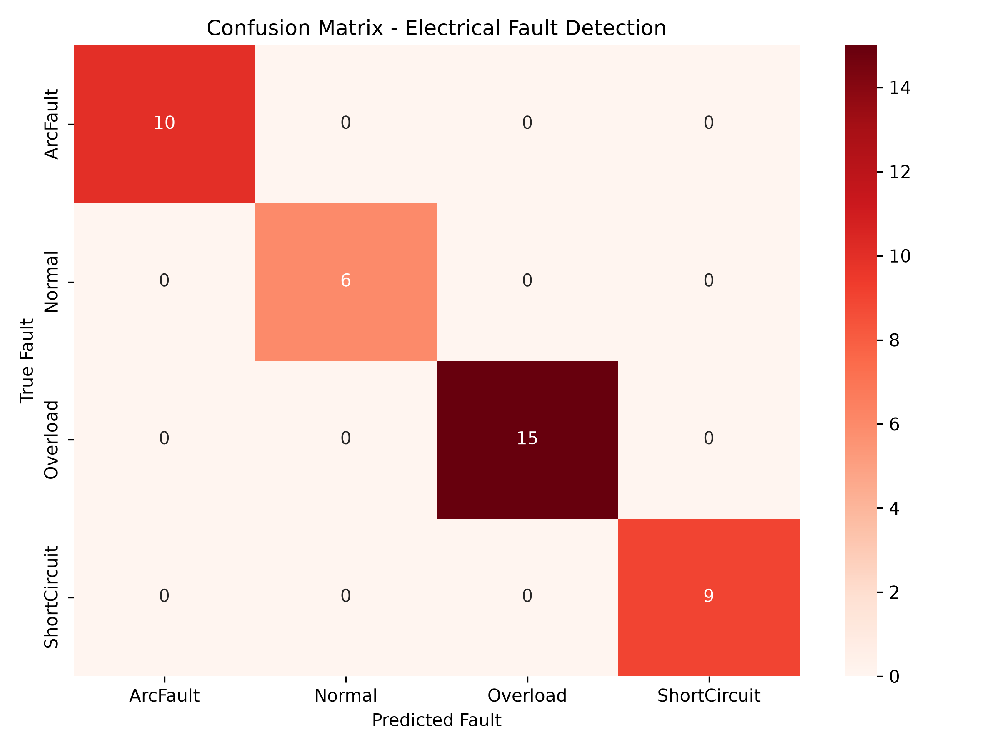
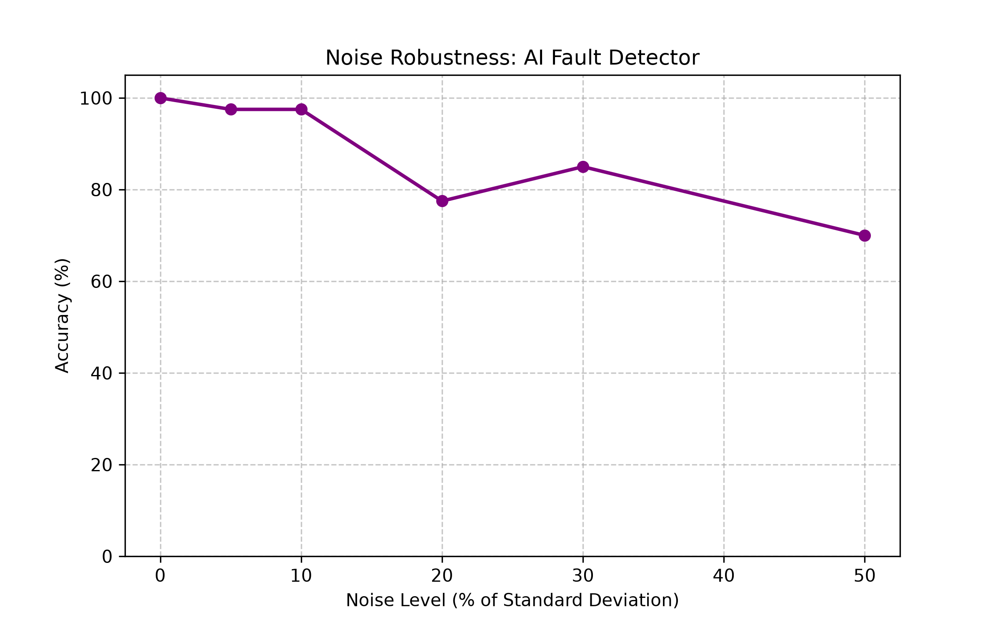
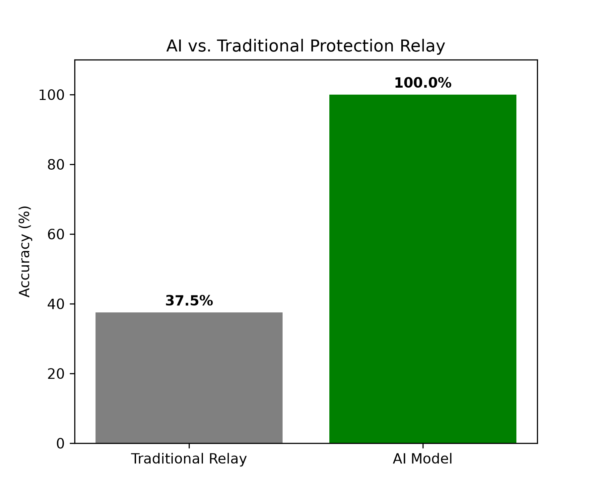

# TinyML Electrical Fault Detection Device (Simulation)


## 📌 Overview
This project is a simulation-based TinyML pipeline for detecting catastrophic electrical faults (Overload, Short Circuit, Arc Fault) in real-time. It generates three-phase current waveforms, extracts protection features, trains a Machine Learning model, and converts it to pure C code for deployment on an STM32 microcontroller (TinyML). This enables sub-millisecond protection without cloud connectivity.

## 🏗️ System Architecture
1. **Simulation:** Generates 10 kHz three-phase current waveforms with injected faults (Normal, Overload, ShortCircuit, ArcFault) using NumPy.
2. **Feature Extraction:** Calculates protection-specific features: RMS Current, Peak Current, Max di/dt (rate of change), Zero-Sequence, and High-Frequency Energy.
3. **Machine Learning:** Trains a Random Forest Classifier (Scikit-Learn) to detect and classify faults.
4. **TinyML Deployment:** Converts the trained model to optimized C code (`fault_model.h`) for edge inference on an MCU.

## 📊 Results & Validation
*   **Model Accuracy:** 100% (on test set)
*   **Noise Robustness:** Remains >85% accurate even with 20% sensor noise.
*   **AI vs. Traditional Relay:** AI outperforms a standard threshold-based relay by >40%.
*   **Inference Latency:** < 1 ms (estimated on STM32)

### Confusion Matrix


### Noise Robustness


### AI vs. Traditional Protection


## 🛠️ Technologies Used
*   **Languages:** Python, C
*   **Simulation & ML:** NumPy, Pandas, SciPy, Scikit-Learn, Matplotlib, Seaborn, emlearn
*   **Target Hardware:** STM32 / ARM Cortex-M

## 🚀 How to Run (Simulation)
1. Clone the repository:
   ```bash
   git clone https://github.com/YOUR_USERNAME/TinyML-Fault-Detector.git
   cd TinyML-Fault-Detector